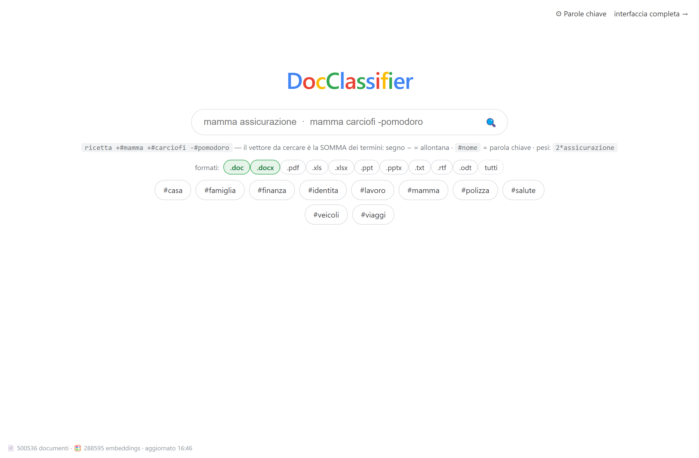
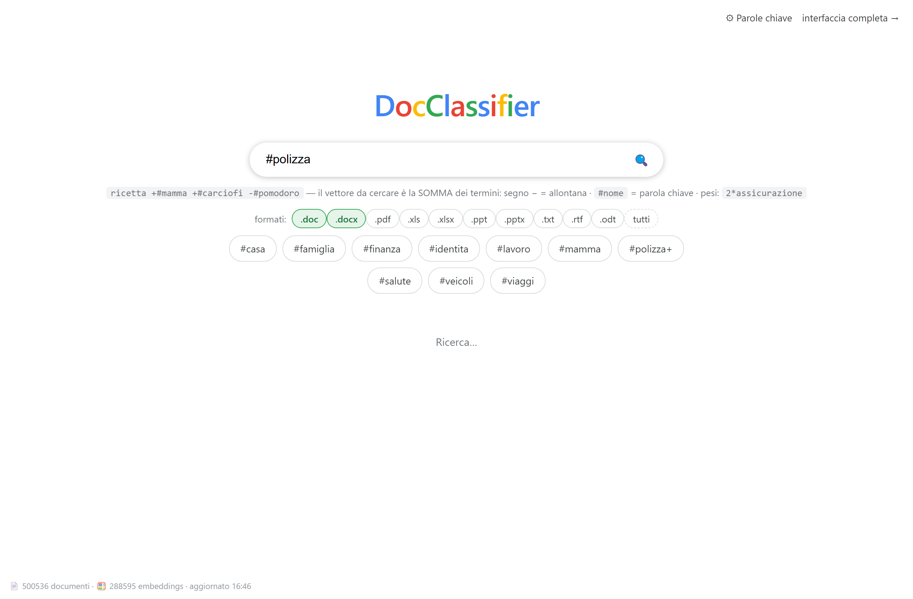
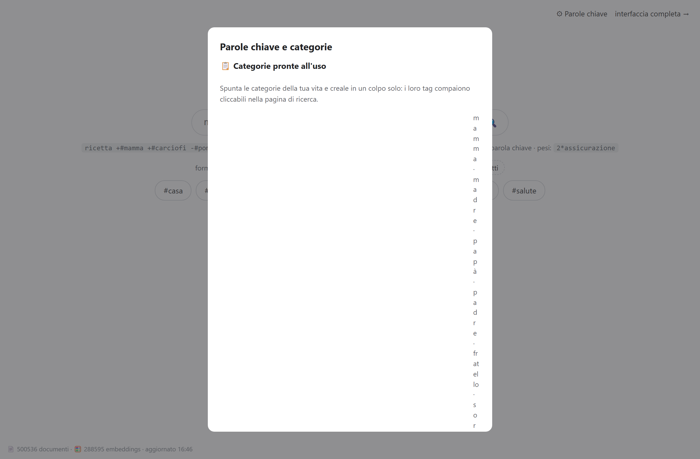

**🌐 English** · [🇮🇹 Italiano](README.it.md)

# DocClassifier — personal document manager in Python



`DocClassifier` (Python package: `devon`) indexes your document folders
into a SQLite database with full-text search, tags, groups (including
"smart" ones), **semantic categories with positive/negative anchors**,
"see also" suggestions, duplicate detection and export to an external
drive.

**It never modifies, moves or deletes your original files**: it reads,
indexes and at most *copies* (with `export`).

It runs on the Python standard library alone (3.10+, tested up to 3.13),
so it works with nothing to install.

## Google-like search with keywords (vector search)

The main search is **vector-based**: every term contributes to the
"to-search" vector with sign and weight.

```
recipe +#mum +#artichokes -#tomato
2*insurance
```

- `+term` pulls closer, `-term` pushes away, `weight*term` weighs it;
- `#name` expands a **keyword**: a composed vector that you define by
  combining phrases, other keywords and sample documents:

```
mum
mom
1.0*"mother"
1.0*#family
-0.5*"brother"
0.5*"D:\photos\mum.jpg"     ← sample document with value
```

A document belongs to the results if its content block is similar to
the composed vector (long documents are split into several blocks: being
close to any one of them is enough). Exact lexical matches — essential
for rare proper names — add a bonus with a relevance hierarchy: word
present → adjacent words → present in the file name.

**Ready-made categories** (family, health, work, finance, home,
vehicles, travel, identity, school, hobby) are created with one click
from the «⚙ Keywords» panel and appear as clickable tags. The **format
filter** (.doc, .docx, .pdf…) is selected under the search box and
remembered by your browser.





## Ready-to-run executables (no Python needed)

GitHub Actions automatically builds self-contained binaries for
**Windows (x64)**, **macOS Intel** and **macOS Apple Silicon**:
*Actions* tab → "Build" workflow → run it or download the artifact for
your platform (pushing a `v…` tag also creates a Release).

```bash
# start the web UI (reachable on the local network)
devon.exe --db D:\archive\library.db serve --host 0.0.0.0 --port 8300
./devon     --db ~/archive/library.db serve --host 0.0.0.0 --port 8300
```

On macOS the binary is unsigned: on first launch right-click → "Open",
or `xattr -d com.apple.quarantine devon`.

## Install from source

```bash
cd DocClassifier               # this project's folder
python3 -m devon init          # creates ~/.devon/library.db
```

Optional, to extract text from PDFs:

```bash
pip3 install --user pypdf
```

## Typical usage

```bash
# 1. index the folders with your documents
python3 -m devon import ~/Documents ~/Desktop ~/Downloads

# 2. search and explore
python3 -m devon search "board meeting"
python3 -m devon search "budget" kind:pdf
python3 -m devon similar 42

# 3. organize with tags, groups and keywords
python3 -m devon tag 42 +personal
python3 -m devon group add Personal
python3 -m devon group put Personal 42 43 44
python3 -m devon group add "Alfa Board" --query "alfa board minutes"

# 4. duplicates and export
python3 -m devon dupes
python3 -m devon export --tag personal --dest /Volumes/Backup/personal

# web UI (opens the browser on http://127.0.0.1:8300)
python3 -m devon serve
```

## The two user interfaces

- **`/` — Google-like search** (the recommended one): logo, search box,
  clickable tags, format filter remembered by the browser, indexing
  status indicator at the bottom left (documents, embeddings, scan in
  progress). Adapts to smartphones automatically.
- **`/classic` — full three-pane interface**: sidebar (types, topics,
  concepts, groups, tags), live search with highlighted snippets,
  document card with actions (open/download file, tags, groups, A/B
  samples for concepts), **Folders & index** panel (persistent sources,
  incremental update of new and modified files with real-time status),
  **Semantic analysis** (embeddings and clustering), **Concepts** (A/B
  classifier), Duplicates view and statistics.

Start it with: `python3 -m devon serve` (options: `--port 8300 --host
127.0.0.1 --no-browser`).

## Semantic search and automatic classification

- **Chunked embeddings** — documents with text are split into
  ~1000-character passages and ALL of the content is vectorized (local
  multilingual model via `fastembed`, numpy for the math); a document
  matches if any of its parts does.
- **Semantic search** — the «semantic» checkbox in the classic web UI
  or the `semsearch` command: ranks by meaning similarity; filters
  (`kind:`, `tag:`…) still apply.
- **Concepts (A/B classifier)** — positive and negative anchors
  (phrases, sample documents by path, file types) scored as
  `sim(XX,A) − sim(XX,B)`; combinable with `@Name`. Optional strict
  file-type filter.
- **Topics (clustering)** — k-means over the vectors assigns each
  document an automatically-labelled topic, filterable with
  `topic:"label"`.
- **Semantic categories** — smart groups with `sem:...` queries
  (combining exact lexical and above-threshold semantic matches).

Commands: `semsearch QUERY` · `embed` · `cluster [-k N] [--all-kinds]` ·
`topics` · `similar ID` · `classify [ID] [--all] [--apply]`

## Search syntax (classic interface)

| Example                      | Effect                                     |
|------------------------------|--------------------------------------------|
| `board meeting`              | documents containing both words            |
| `board*`                     | prefix (boarding, boards…)                 |
| `-draft`                     | excludes documents containing "draft"      |
| `tag:personal`               | only documents with that tag               |
| `kind:pdf` `kind:email`      | filter by type                             |
| `ext:.docx`                  | filter by extension                        |
| `path:board`                 | filter on the file path                    |
| `group:personal`             | inside a group                             |
| `topic:"07 · minutes"`       | inside an automatic topic                  |

Accents are not an issue: `perché` also finds `perche`.

## Commands

```
init            creates/opens the database
import PATH…    indexes folders or files (incremental: detects new and modified)
ls              lists documents (--kind --tag --group --json)
search QUERY    full-text search with highlighted snippet
show ID         details, text, tags, groups, see-also
rm ID…          removes from the INDEX (files stay untouched)
tag ID +t -t    adds/removes tags
tags            lists tags in use
group add|ls|rm|put   plain and smart groups (--query "sem:…")
similar ID      similar documents (embeddings or TF-IDF)
semsearch QUERY semantic search
embed           computes embeddings (incremental)
cluster [-k N]  groups documents into topics by content
topics          lists the topics
classify [ID]   suggests/assigns groups by content
dupes           duplicate groups (same content, SHA-256)
stats           archive statistics
check           indexed files no longer on disk
export          copies documents (by query, tag, group or ID) to a folder
serve           web UI (default port 8300, opens the browser)
```

Global option `--db PATH` (or the `DEVON_DB` environment variable).

## Supported file formats

- **Direct text**: txt, md, csv, json, xml, html, rtf, source code
- **Office (zip/XML)**: docx, xlsx, pptx, odt, ods, odp, epub — with no
  external dependencies
- **Legacy binary Office**: doc, xls, ppt — heuristic text extraction
  (cp1252 and UTF-16) straight from the bytes
- **Email**: .eml / .emlx (headers + body)
- **PDF**: text via `pypdf` (optional); OCR via `pytesseract` +
  Tesseract (optional) for scans
- **Images**: optional OCR as above
- **All other formats**: indexed with metadata (name, path, date, hash)
  and searchable by name

## Windows

Two ready-made launchers: `avvia-devon-web.bat` (web UI on 0.0.0.0:8300
with the database in `D:\devon\library.db`) and `importa-C-D.bat`
(indexes C:\ and D:\ skipping system areas). For access from other LAN
computers:

```bat
netsh advfirewall firewall add rule name="devon web 8300" dir=in action=allow protocol=TCP localport=8300
```

(from an **administrator** terminal, once)

## Where is my data?

Everything lives in a single SQLite file (`~/.devon/library.db`, or the
`--db`/`DEVON_DB` path): backup = copy the file; fresh start = delete
it; the index can always be rebuilt by re-running `import`.

## Project structure

```
devon/
├── db.py        SQLite schema (documents, FTS5, tags, groups,
│                keywords, concepts, embeddings) + migrations
├── extract.py   per-format text extraction (Office, PDF, email…)
├── ingest.py    recursive scan, SHA-256 hash, sources
├── search.py    query parser + FTS5 search with snippets
├── semantic.py  chunked embeddings, vector search, clustering,
│                A/B concepts
├── similar.py   see-also (TF-IDF / embeddings)
├── cli.py       command line interface
└── webapp.py    web UI (JSON API + two front-ends, stdlib only)
```

---

**🌐 English** · [🇮🇹 Italiano](README.it.md)
